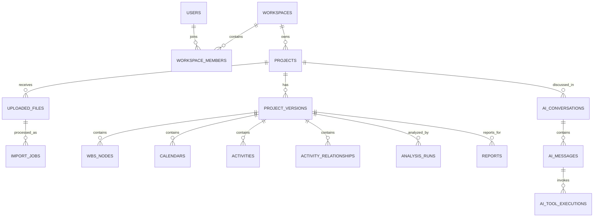

# Data Model & Canonical Project Schema — v1.0

## 1. Data modeling principles

1. Tenant ownership is explicit through workspace ownership/membership.
2. Each imported update creates an immutable `project_version`.
3. Source file, import job, parser version, and mappings are traceable.
4. Source identifiers are preserved alongside platform UUIDs.
5. Schedule entities are version-scoped so users can compare updates without overwriting history.
6. Derived analytics are linked to the exact version and engine version used.
7. Raw file content is stored in private object storage, not in relational tables.

## 2. Entity relationship overview

## 3. Main entities

### Identity and tenant

**users** — application-level profile linked to an authentication subject. Do not store passwords here when using an external auth provider.

**workspaces** — tenant boundary. Personal workspace is created at signup. Future team plans add more members.

**workspace_members** — user membership and role (`owner`, `admin`, `member`, `viewer`). v1 UX can expose owner-only while schema supports future collaboration.

### Project and version

**projects** — logical project container (e.g., EPC Gas Processing Facility).

**project_versions** — immutable snapshot created after a confirmed import. Includes version number, data date, source file, import metadata, parser version, and status.

A project can have multiple versions. Comparisons should explicitly reference `from_version_id` and `to_version_id`.

### Ingestion

**uploaded_files** — private storage metadata, checksum, MIME type, size, source format, uploader, and lifecycle status.

**import_jobs** — asynchronous parse/normalize/validate operation, with structured summary and error/warning details.

**import_mappings** — reusable Excel/CSV column mapping profile. Keep mapping configuration versioned.

### Schedule entities

**wbs_nodes** — hierarchy within one project version, preserving source WBS code/ID and parent relation.

**calendars** — source calendar metadata and the subset of working-time details that the parser supports. Do not pretend full P6 calendar fidelity until implemented/tested.

**activities** — canonical activity rows with source identifiers, WBS, dates, durations, progress basis, float values, status, and custom source attributes.

**activity_relationships** — predecessor/successor links and relationship type/lag. Preserve source identifiers and flags for cross-project/external relationships.

**baseline_activity_values** — optional baseline dates/durations/progress values associated with a project version. A baseline may be absent or incomplete.

### Intelligence and outputs

**analysis_runs** — deterministic engine execution with input version, method, parameters, output JSON, engine version, and warnings.

**analysis_findings** — normalized findings from schedule checks or comparisons, with severity and evidence payload.

**ai_conversations / ai_messages** — project-scoped AI history. Version context is stored per conversation/message.

**ai_tool_executions** — tool name, validated arguments, output summary, status, duration, and references. Avoid persisting excessive raw payloads.

**reports** — generated artifact metadata, selected project version, report type, storage key, and generation status.

**usage_events** — metering for import, analysis, AI, simulation, and report operations.

## 4. Canonical activity fields

| Canonical field | Type | Description | Notes |
|---|---|---|---|
| `id` | UUID | Platform identity | Stable within project version. |
| `project_version_id` | UUID | Version reference | Required. |
| `source_activity_id` | text | Original P6 task/activity identifier | Preserve exact value. |
| `activity_code` | text | Human-readable activity ID/code | May differ from source PK. |
| `activity_name` | text | Activity name | Required where available. |
| `wbs_node_id` | UUID | Canonical WBS link | Nullable if source missing. |
| `activity_type` | text | Source activity type | Preserve raw value. |
| `status` | text | Not started / in progress / complete / unknown | Store normalized + raw source. |
| `start_date` | timestamptz/date | Start date from source | Preserve source timezone semantics. |
| `finish_date` | timestamptz/date | Finish date from source | Do not silently change timezone. |
| `actual_start` | date | Actual start | Nullable. |
| `actual_finish` | date | Actual finish | Nullable. |
| `remaining_duration_hours` | numeric | Remaining duration normalized to hours | Preserve source unit separately if needed. |
| `original_duration_hours` | numeric | Original duration | Nullable. |
| `actual_duration_hours` | numeric | Actual duration | Nullable. |
| `total_float_hours` | numeric | Total float normalized to hours | Source or engine-derived field must be identified. |
| `free_float_hours` | numeric | Free float normalized to hours | Nullable. |
| `physical_pct_complete` | numeric | Physical % complete | Only populated when basis is known. |
| `duration_pct_complete` | numeric | Duration % complete | Distinct from physical %. |
| `units_pct_complete` | numeric | Units % complete | Distinct from other progress bases. |
| `percent_complete_type` | text | Source basis | Preserve raw source classification. |
| `source_fields` | JSONB | Selected raw source attributes | Bounded; avoid dumping entire row if huge. |

## 5. Relationship fields

- `predecessor_source_id`
- `successor_source_id`
- `relationship_type` (FS, SS, FF, SF where supported)
- `lag_hours`
- `is_external`
- `source_relationship_id`
- `source_fields`

If the parser encounters a relationship type it cannot normalize, preserve the raw value and flag it. Do not silently coerce.

## 6. Version comparison keys

Preferred activity matching key:
1. Stable P6 source activity identifier within the same source project lineage.
2. If unavailable, activity code plus project lineage, subject to uniqueness check.
3. Never match only on activity name.

Comparison output categories:
- `added`
- `removed`
- `changed`
- `unchanged`
- `ambiguous_match`

Track changes to key fields: name, WBS, status, dates, durations, total/free float, percent complete, relationship set.

## 7. Data lineage requirements

Every project version must link to:
- uploaded file ID;
- source checksum;
- source format and parser version;
- import mapping profile (when relevant);
- source project ID/code when present;
- project data date;
- import confirmation user and time.

Every analytic result must link to:
- project version ID;
- engine/version;
- method and parameters;
- creation timestamp;
- warnings and data-quality limitations.

Every AI answer must retain the selected project version and tool execution references used to formulate it.

## 8. Data quality states

Recommended quality flags:
- `missing_data_date`
- `missing_activity_identifier`
- `duplicate_activity_identifier`
- `orphan_wbs_reference`
- `orphan_relationship_reference`
- `unsupported_relationship_type`
- `missing_calendar_reference`
- `invalid_date_range`
- `percent_complete_out_of_range`
- `ambiguous_activity_match`
- `baseline_unavailable`

Severity: `info`, `warning`, `error`, `blocking`.

## 9. Privacy and lifecycle

- Source file and report objects are private.
- Deleting a project should soft-delete first and schedule a retention-aware purge.
- Deleting a version should be blocked if used by an immutable audit/report policy unless user confirms the consequences.
- Define whether AI prompts/tool payloads are retained, for how long, and whether they can be deleted independently.
