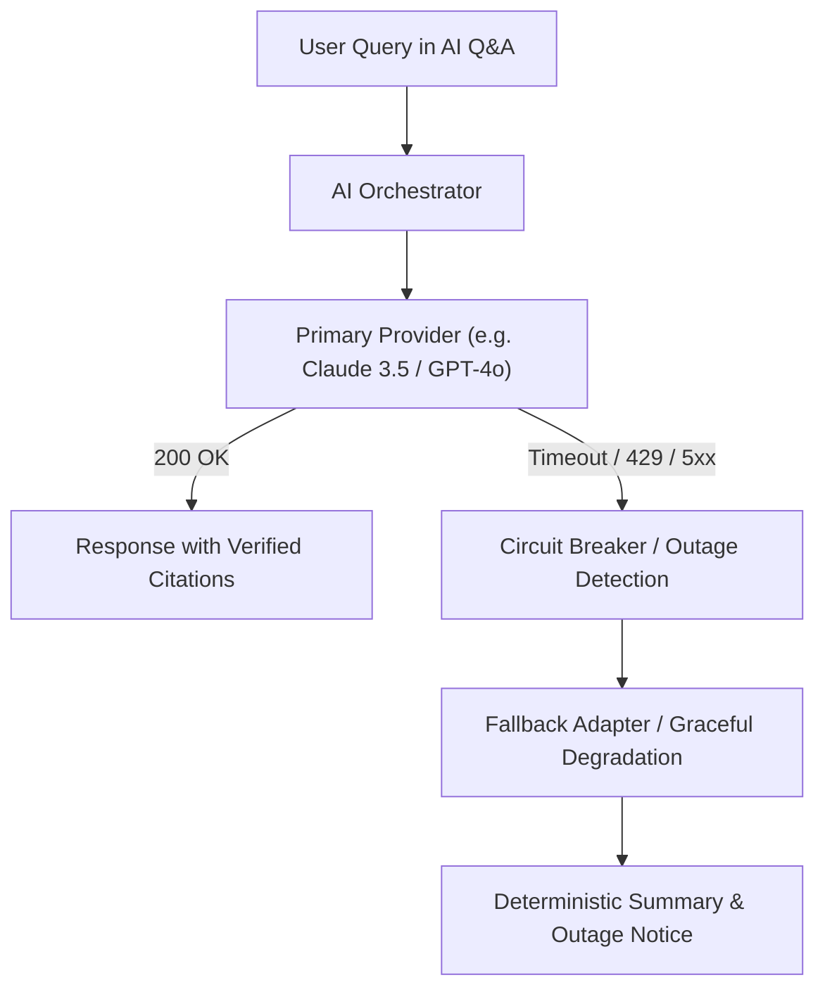

# AI Provider Outage & Fallback Runbook

## 1. Overview & Fallback Strategy

The Project Intelligence Platform uses AI orchestration strictly bounded by deterministic domain calculation tools. If external AI LLM providers (e.g. OpenAI, Anthropic, Gemini) experience outages, rate limiting, or network timeouts, the system must fail gracefully without disrupting core schedule analytics.



---

## 2. Common Failure Modes & Symptoms

| Failure Mode | Symptoms | Trigger Condition |
|---|---|---|
| **Rate Limit Exceeded (HTTP 429)** | `RateLimitError` in API logs, elevated turn latency. | Quota exhaustion on tenant or workspace billing plan. |
| **Provider Downtime (HTTP 502/503/504)** | Timeouts exceeding 15 seconds, connection resets. | Cloud vendor service degradation. |
| **Context Window Overflow** | `InvalidRequestError` or 400 Bad Request. | Conversation history too long for LLM token budget. |

---

## 3. Incident Mitigation Procedures

### Step 1: Detect and Inspect Provider Errors
Check the API logs for provider errors:
```bash
docker compose -f docker-compose.prod.yml logs --tail=100 api | grep "ai.provider_error"
```

### Step 2: Emergency Switch to Secondary Provider
If the primary provider is suffering an extended outage:
1. Update `.env.prod` to point to the backup provider:
   ```bash
   AI_DEFAULT_PROVIDER=anthropic   # Or openai / mock
   ```
2. Restart API without downtime:
   ```bash
   docker compose -f docker-compose.prod.yml up -d --no-deps api
   ```

### Step 3: Enabling Mock Adapter for Testing or Complete Blackout
In development or staging environments, the system includes `MockAIProviderAdapter`:
```python
from app.adapters.ai.mock_adapter import MockAIProviderAdapter

# Automatically satisfies tool call protocols and deterministic answers
mock_adapter = MockAIProviderAdapter(model="mock-epc-1")
```

### Step 4: User Notification
If all providers are unreachable, the UI surfaces a non-blocking toast:
> *"AI Assistant service is currently experiencing upstream provider delays. Deterministic schedule metrics, quality checks, and reports remain 100% operational."*

