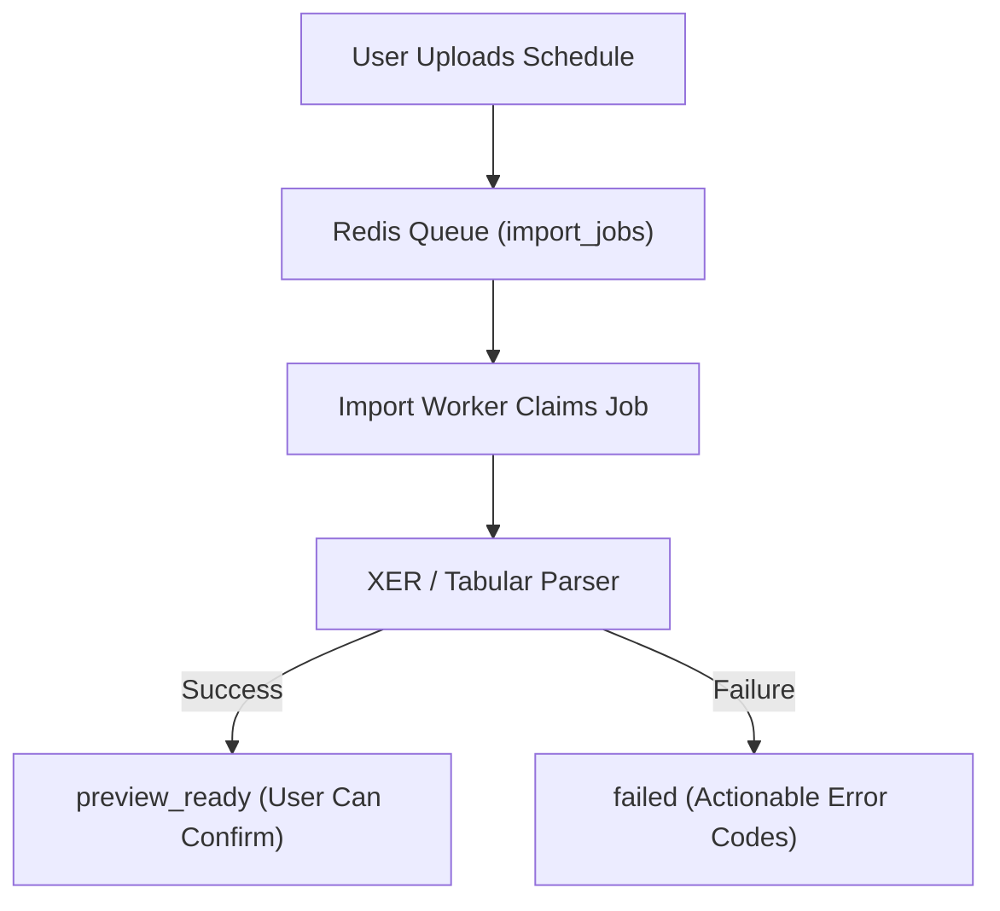

# Import Failure & Job Triage Runbook

## 1. Overview & Triage Workflow

When an EPC schedule file (`.xer`, `.xlsx`, `.csv`) fails during ingestion or gets stuck, the background worker flags the job status as `failed` with actionable machine-readable error codes.



---

## 2. Common Error Codes & Mitigations

| Error Code | Root Cause | Operator / User Action |
|---|---|---|
| `UPLOADED_FILE_NOT_FOUND` | Storage file missing or object key mismatched. | Ask user to re-upload. Inspect private storage volume mounts. |
| `STORAGE_OBJECT_NOT_FOUND` | Physical file deleted or unmounted. | Verify storage volume connectivity. |
| `CORRUPT_XER_HEADER` | XER file lacks `ERMHDR` header or has invalid encoding. | User must re-export from Primavera P6 in standard XER format. |
| `UNSUPPORTED_P6_VERSION` | P6 schema version is unsupported or malformed. | Verify XER header line (e.g. `ERMHDR 20.12`). |
| `MISSING_REQUIRED_COLUMNS` | Tabular CSV/Excel file lacks activity code, start, or finish. | User must apply column mapping in the Mapping Wizard. |

---

## 3. Investigating Stuck or Failed Jobs

### 1. Find Failed Job Details:
```bash
docker compose -f docker-compose.prod.yml exec api uv run python -c "
import asyncio, uuid
from app.db.session import async_session_factory
from app.models.project import ImportJob
from sqlalchemy import select

async def check():
    async with async_session_factory() as s:
        res = await s.execute(select(ImportJob).where(ImportJob.status == 'failed').limit(5))
        for j in res.scalars():
            print(f'Job {j.id}: errors={j.errors}, warnings={j.warnings}')

asyncio.run(check())
"
```

### 2. Retrying a Stuck Job:
If a job is stuck in `processing` due to an unexpected worker crash:
```bash
docker compose -f docker-compose.prod.yml exec api uv run python -c "
import asyncio, uuid
from app.db.session import async_session_factory
from app.models.project import ImportJob
from app.adapters.queue.redis_queue import RedisQueueAdapter
from app.core.config import get_settings

async def requeue(job_id_str):
    settings = get_settings()
    q = RedisQueueAdapter(settings.redis_url)
    await q.enqueue_import_job(uuid.UUID(job_id_str))
    print('Requeued successfully')

# asyncio.run(requeue('<STUCK_JOB_UUID>'))
"
```

