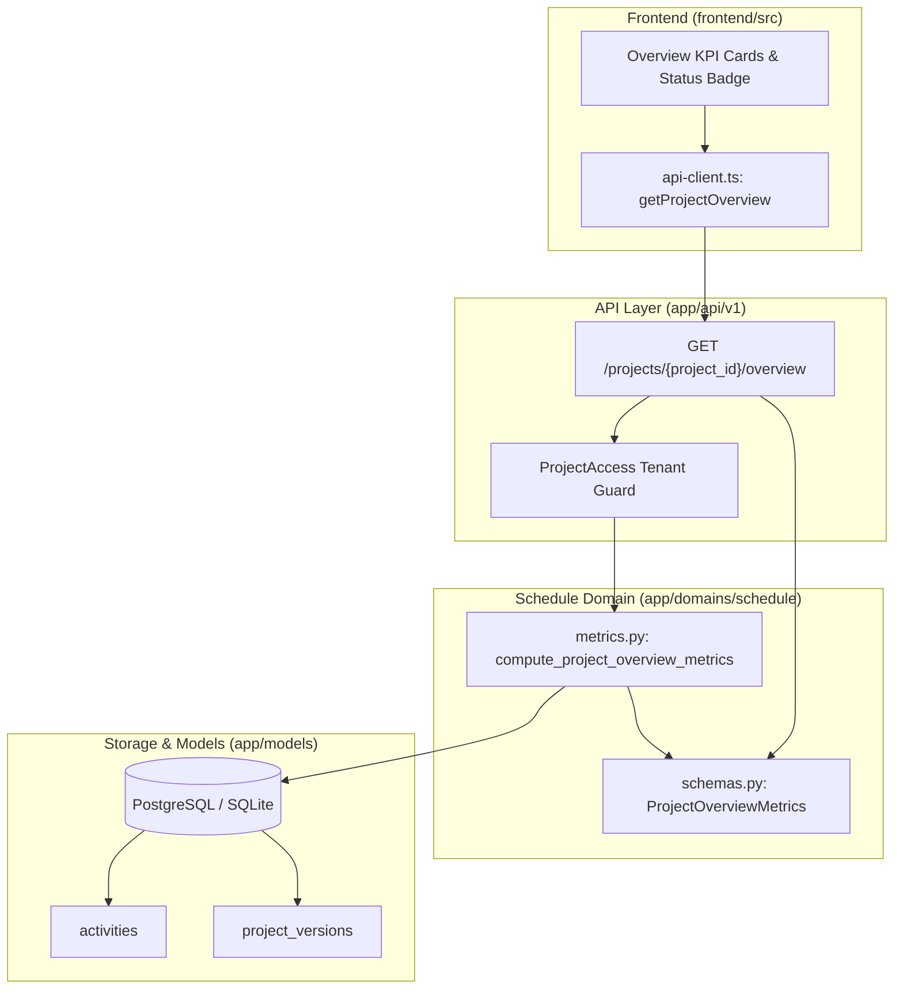

# PI-030: Project Overview Metrics Implementation Plan

> **For agentic workers:** REQUIRED SUB-SKILL: Use superpowers:subagent-driven-development to implement this plan task-by-task. Steps use checkbox (`- [ ]`) syntax for tracking.

**Goal:** Implement deterministic project overview metrics for a selected project version, computing activity status distribution, critical count, data date, finish date, and ensuring missing fields display as unavailable rather than zero.

**Architecture:**
Deterministic metrics calculations live in `backend/app/domains/schedule/metrics.py`, decoupled from HTTP frameworks. The endpoint `GET /api/v1/projects/{project_id}/overview?version_id=` routes through tenant-scoped security dependencies and calls the domain service. The typed frontend client consumes the endpoint, displaying KPI cards with explicit source/version annotations.

**Architecture Diagram:**



**Tech Stack:** Python 3.11, FastAPI, SQLAlchemy 2.0 (asyncio), Pydantic v2, Next.js 16 (App Router), TypeScript.

**Spec:** `08_DEVELOPMENT_BACKLOG.md` (PI-030), `06_API_SPEC.md` (Section 5), `07_UI_UX_SPEC.md` (Screen D), `02_SYSTEM_ARCHITECTURE.md`.

## Global Constraints

- Domain isolation: `app/domains/schedule` must NOT import `fastapi`, `starlette`, `openai`, `app.adapters`, `app.api`, `app.domains.ingestion`, or `app.domains.ai`.
- Deterministic calculation: No LLM/AI estimation in metric calculations; 100% deterministic SQL aggregations.
- Unavailable data rule: Missing numeric/date fields (e.g. float, physical percent complete) must be returned as `None` (JSON `null`), NEVER coerced to `0` or `0.0`.
- Multi-tenant security: All queries must be scoped to the authenticated user's workspace.

---

### Task 1: Schedule Domain Schemas and Metrics Service

**Files:**
- Create: `backend/app/domains/schedule/metrics.py`
- Modify: `backend/app/domains/schedule/schemas.py:100-147`
- Modify: `backend/app/domains/schedule/__init__.py:1-25`
- Test: `backend/tests/test_schedule_metrics_service.py`

**Interfaces:**
- Produces:
  ```python
  class ActivityStatusDistribution(BaseModel):
      not_started: int
      in_progress: int
      complete: int
      suspended: int
      unknown: int

  class ProjectOverviewMetrics(BaseModel):
      project_id: uuid.UUID
      project_name: str
      version_id: uuid.UUID
      version_number: int
      version_label: str
      data_date: date | None = None
      project_start_date: date | None = None
      project_finish_date: date | None = None
      source_filename: str | None = None
      source_format: str | None = None
      total_activities: int
      status_distribution: ActivityStatusDistribution
      milestones_count: int
      critical_activities_count: int
      near_critical_activities_count: int
      min_total_float_hours: float | None = None
      max_total_float_hours: float | None = None
      avg_physical_pct_complete: float | None = None
      calendars_count: int
      wbs_nodes_count: int
      relationships_count: int
      warnings_count: int

  async def compute_project_overview_metrics(
      session: AsyncSession,
      project_id: uuid.UUID,
      version_id: uuid.UUID | None = None,
      critical_float_threshold_hours: float = 0.0,
      near_critical_float_threshold_hours: float = 80.0,
  ) -> ProjectOverviewMetrics: ...
  ```

- [ ] **Step 1: Write failing unit test for metrics service**
  Test with direct session fixtures (in-memory SQLite) checking activity counts, status counts, null-handling (float and physical percent complete remaining None).

- [ ] **Step 2: Run test to verify it fails**
  `cd backend && uv run pytest tests/test_schedule_metrics_service.py`

- [ ] **Step 3: Implement domain schemas and `compute_project_overview_metrics`**
  Add schemas to `schemas.py` and implement aggregations in `metrics.py`. Ensure `func.avg(Activity.physical_pct_complete)` and `func.min(Activity.total_float_hours)` return `None` when no records have values.

- [ ] **Step 4: Run test to verify it passes**
  `cd backend && uv run pytest tests/test_schedule_metrics_service.py`

- [ ] **Step 5: Run architecture isolation test**
  `cd backend && uv run pytest tests/test_architecture.py`

---

### Task 2: API Route `GET /api/v1/projects/{project_id}/overview`

**Files:**
- Modify: `backend/app/api/v1/routes.py`
- Create: `backend/tests/test_project_overview.py`

**Interfaces:**
- Produces:
  ```python
  @router.get("/projects/{project_id}/overview", response_model=ProjectOverviewMetrics)
  async def get_project_overview(
      project: ProjectAccess,
      session: SessionDep,
      version_id: uuid.UUID | None = Query(default=None),
  ) -> ProjectOverviewMetrics: ...
  ```

- [ ] **Step 1: Write integration tests for endpoint**
  - Confirmed XER fixture overview test (`p6_release_82_facility.xer`).
  - Missing fields check: float and physical percent complete are `None`, not `0.0`.
  - Version selection: explicit `?version_id=` vs default latest version.
  - No versions available returns 404 `NO_VERSION_AVAILABLE`.
  - Tenant isolation: cross-tenant access returns 404.

- [ ] **Step 2: Run test to verify it fails**
  `cd backend && uv run pytest tests/test_project_overview.py`

- [ ] **Step 3: Implement endpoint in `backend/app/api/v1/routes.py`**
  Connect `ProjectAccess` guard to `compute_project_overview_metrics`.

- [ ] **Step 4: Run test to verify it passes**
  `cd backend && uv run pytest tests/test_project_overview.py`

- [ ] **Step 5: Lint, format, and mypy**
  `cd backend && uv run ruff check . --fix && uv run ruff format . && uv run mypy`

---

### Task 3: Frontend API Client and Type Definitions

**Files:**
- Modify: `frontend/src/lib/api-client.ts`
- Modify: `frontend/src/lib/api-client.test.ts`

**Interfaces:**
- Produces:
  ```typescript
  export interface ActivityStatusDistribution {
    not_started: number;
    in_progress: number;
    complete: number;
    suspended: number;
    unknown: number;
  }

  export interface ProjectOverviewMetrics {
    project_id: string;
    project_name: string;
    version_id: string;
    version_number: number;
    version_label: string;
    data_date: string | null;
    project_start_date: string | null;
    project_finish_date: string | null;
    source_filename: string | null;
    source_format: string | null;
    total_activities: number;
    status_distribution: ActivityStatusDistribution;
    milestones_count: number;
    critical_activities_count: number;
    near_critical_activities_count: number;
    min_total_float_hours: number | null;
    max_total_float_hours: number | null;
    avg_physical_pct_complete: number | null;
    calendars_count: number;
    wbs_nodes_count: number;
    relationships_count: number;
    warnings_count: number;
  }

  export async function getProjectOverview(
    projectId: string,
    versionId?: string
  ): Promise<ProjectOverviewMetrics>;
  ```

- [ ] **Step 1: Write test for `getProjectOverview` in `api-client.test.ts`**
- [ ] **Step 2: Run frontend test to verify failure**
  `cd frontend && npm test`
- [ ] **Step 3: Implement `getProjectOverview` in `api-client.ts`**
- [ ] **Step 4: Run frontend test to verify pass**
  `cd frontend && npm test`

---

### Task 4: Full Monorepo Quality Gate Verification

- [ ] **Step 1: Run monorepo check**
  `npm run check` (runs backend ruff, format, mypy, pytest, and frontend lint, typecheck, test)
- [ ] **Step 2: Run frontend build**
  `cd frontend && npm run build`

