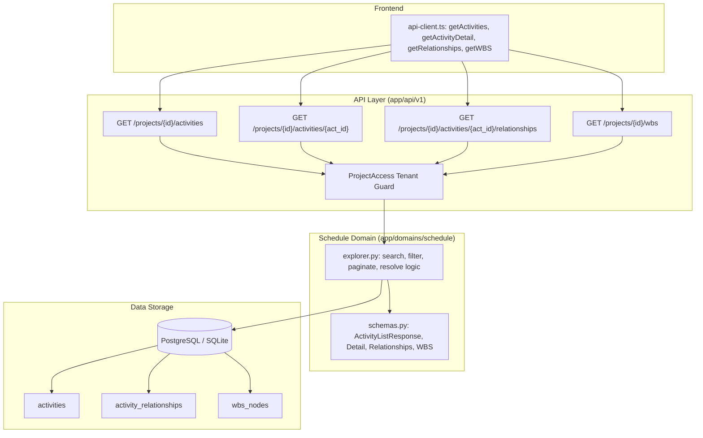

# PI-031: Activity and WBS Explorer Implementation Plan

> **For agentic workers:** REQUIRED SUB-SKILL: Use superpowers:subagent-driven-development to implement this plan task-by-task. Steps use checkbox (`- [ ]`) syntax for tracking.

**Goal:** Implement server-side search, filtering, and pagination for activities, activity detail with source provenance, within-version predecessor/successor relationship resolution, and WBS tree explorer.

**Architecture:**
Deterministic schedule explorer functions reside in `backend/app/domains/schedule/explorer.py`. Endpoints in `backend/app/api/v1/routes.py` leverage `ProjectAccess` tenant-scoped security. All relationship joins enforce strict version boundaries (`project_version_id`). The typed frontend client consumes these endpoints for search, filtering, drawer details, and WBS hierarchy.

**Architecture Diagram:**



**Tech Stack:** Python 3.11, FastAPI, SQLAlchemy 2.0 (asyncio), Pydantic v2, TypeScript, Next.js 16.

**Spec:** `08_DEVELOPMENT_BACKLOG.md` (PI-031), `06_API_SPEC.md` (Section 5), `07_UI_UX_SPEC.md` (Screen F).

## Global Constraints

- Domain isolation: `app/domains/schedule` must NOT import `fastapi`, `starlette`, `openai`, `app.adapters`, `app.api`, `app.domains.ingestion`, or `app.domains.ai`.
- Server-side filtering: Search (`q`), status, WBS, and float filters MUST be evaluated in the database query, not client-side.
- Same-version link resolution: Predecessor and successor links must resolve ONLY to activities within the exact same `project_version_id`.
- Provenance preservation: Raw source identifiers (`source_activity_id`) and `source_fields` must be accessible in detail views.
- Tenant isolation: Multi-tenant boundary must prevent cross-workspace data access.

---

### Task 1: Schedule Domain Explorer Schemas and Service

**Files:**
- Create: `backend/app/domains/schedule/explorer.py`
- Modify: `backend/app/domains/schedule/schemas.py`
- Modify: `backend/app/domains/schedule/__init__.py`
- Test: `backend/tests/test_activity_explorer_service.py`

**Interfaces:**
- Produces:
  ```python
  class ActivityListItem(BaseModel):
      id: uuid.UUID
      source_activity_id: str
      activity_code: str | None
      activity_name: str
      status: str
      activity_type: str | None
      wbs_node_id: uuid.UUID | None
      wbs_code: str | None
      wbs_name: str | None
      calendar_id: uuid.UUID | None
      calendar_name: str | None
      start_date: date | None
      finish_date: date | None
      planned_start: date | None
      planned_finish: date | None
      actual_start: date | None
      actual_finish: date | None
      remaining_duration_hours: float | None
      total_float_hours: float | None
      physical_pct_complete: float | None

  class ActivityListResponse(BaseModel):
      items: list[ActivityListItem]
      total: int
      limit: int
      offset: int

  class RelationshipItem(BaseModel):
      relationship_id: uuid.UUID
      relationship_type: str
      lag_hours: float
      is_external: bool
      activity_id: uuid.UUID
      activity_code: str | None
      activity_name: str
      status: str

  class ActivityRelationshipsResponse(BaseModel):
      activity_id: uuid.UUID
      predecessors: list[RelationshipItem]
      successors: list[RelationshipItem]

  class ActivityDetail(ActivityListItem):
      source_status: str | None = None
      original_duration_hours: float | None = None
      actual_duration_hours: float | None = None
      free_float_hours: float | None = None
      duration_pct_complete: float | None = None
      units_pct_complete: float | None = None
      percent_complete_type: str | None = None
      source_fields: dict[str, Any] = Field(default_factory=dict)
      baselines: list[dict[str, Any]] = Field(default_factory=list)

  class WBSNodeItem(BaseModel):
      id: uuid.UUID
      source_wbs_id: str | None
      wbs_code: str | None
      wbs_name: str
      parent_wbs_node_id: uuid.UUID | None
      sort_order: int | None
      activity_count: int

  async def list_activities(
      session: AsyncSession,
      project_id: uuid.UUID,
      version_id: uuid.UUID | None = None,
      q: str | None = None,
      status: str | None = None,
      wbs_id: uuid.UUID | None = None,
      float_max: float | None = None,
      limit: int = 50,
      offset: int = 0,
  ) -> ActivityListResponse: ...

  async def get_activity_detail(
      session: AsyncSession,
      project_id: uuid.UUID,
      activity_id: uuid.UUID,
      version_id: uuid.UUID | None = None,
  ) -> ActivityDetail | None: ...

  async def get_activity_relationships(
      session: AsyncSession,
      project_id: uuid.UUID,
      activity_id: uuid.UUID,
      version_id: uuid.UUID | None = None,
  ) -> ActivityRelationshipsResponse | None: ...

  async def get_wbs_tree(
      session: AsyncSession,
      project_id: uuid.UUID,
      version_id: uuid.UUID | None = None,
  ) -> list[WBSNodeItem]: ...
  ```

- [ ] **Step 1: Write failing unit tests for explorer service**
  Test in `tests/test_activity_explorer_service.py` with in-memory SQLite:
  - Search by code and name (`q`)
  - Filter by status, WBS node ID, and float maximum
  - Pagination limit and offset calculation
  - Activity detail with `source_fields` and baselines
  - Predecessor and successor resolution within version
  - WBS tree with activity counts

- [ ] **Step 2: Run test to verify it fails**
  `cd backend && uv run pytest tests/test_activity_explorer_service.py`

- [ ] **Step 3: Implement schemas and explorer functions**
  Add schemas to `schemas.py` and implement queries in `explorer.py`.

- [ ] **Step 4: Run test to verify it passes**
  `cd backend && uv run pytest tests/test_activity_explorer_service.py`

- [ ] **Step 5: Run architecture isolation check**
  `cd backend && uv run pytest tests/test_architecture.py`

---

### Task 2: API Route Handlers

**Files:**
- Modify: `backend/app/api/v1/routes.py`
- Create: `backend/tests/test_activity_explorer.py`

**Interfaces:**
- Endpoints:
  - `GET /api/v1/projects/{project_id}/activities`
  - `GET /api/v1/projects/{project_id}/activities/{activity_id}`
  - `GET /api/v1/projects/{project_id}/activities/{activity_id}/relationships`
  - `GET /api/v1/projects/{project_id}/wbs`

- [ ] **Step 1: Write integration tests for API endpoints**
  - Activity search and pagination with P6 XER fixture (`p6_release_82_facility.xer`).
  - Filter by `status="in_progress"` and `float_max=0.0`.
  - Detail endpoint returns 200 with `source_activity_id` and provenance `source_fields`.
  - Relationship endpoint returns predecessors and successors.
  - WBS endpoint returns nodes and activity counts.
  - Cross-tenant isolation tests on all 4 endpoints.

- [ ] **Step 2: Run test to verify it fails**
  `cd backend && uv run pytest tests/test_activity_explorer.py`

- [ ] **Step 3: Implement endpoints in `routes.py`**
  Connect `ProjectAccess` dependency and call `explorer.py` functions.

- [ ] **Step 4: Run test to verify it passes**
  `cd backend && uv run pytest tests/test_activity_explorer.py`

- [ ] **Step 5: Run lint, format, and mypy**
  `cd backend && uv run ruff check . --fix && uv run ruff format . && uv run mypy`

---

### Task 3: Frontend API Client Methods and Types

**Files:**
- Modify: `frontend/src/lib/api-client.ts`
- Modify: `frontend/src/lib/api-client.test.ts`

**Interfaces:**
- Produces:
  ```typescript
  export interface ActivityListItem {
    id: string;
    source_activity_id: string;
    activity_code: string | null;
    activity_name: string;
    status: string;
    activity_type: string | null;
    wbs_node_id: string | null;
    wbs_code: string | null;
    wbs_name: string | null;
    calendar_id: string | null;
    calendar_name: string | null;
    start_date: string | null;
    finish_date: string | null;
    planned_start: string | null;
    planned_finish: string | null;
    actual_start: string | null;
    actual_finish: string | null;
    remaining_duration_hours: number | null;
    total_float_hours: number | null;
    physical_pct_complete: number | null;
  }

  export interface ActivityListResponse {
    items: ActivityListItem[];
    total: number;
    limit: number;
    offset: number;
  }

  export interface RelationshipItem {
    relationship_id: string;
    relationship_type: string;
    lag_hours: number;
    is_external: boolean;
    activity_id: string;
    activity_code: string | null;
    activity_name: string;
    status: string;
  }

  export interface ActivityRelationshipsResponse {
    activity_id: string;
    predecessors: RelationshipItem[];
    successors: RelationshipItem[];
  }

  export interface ActivityDetail extends ActivityListItem {
    source_status: string | null;
    original_duration_hours: number | null;
    actual_duration_hours: number | null;
    free_float_hours: number | null;
    duration_pct_complete: number | null;
    units_pct_complete: number | null;
    percent_complete_type: string | null;
    source_fields: Record<string, unknown>;
    baselines: Record<string, unknown>[];
  }

  export interface WBSNodeItem {
    id: string;
    source_wbs_id: string | null;
    wbs_code: string | null;
    wbs_name: string;
    parent_wbs_node_id: string | null;
    sort_order: number | null;
    activity_count: number;
  }

  export const api = {
    // ... existing methods
    getActivities: (projectId: string, params?: { versionId?: string; q?: string; status?: string; wbsId?: string; floatMax?: number; limit?: number; offset?: number }, token?: string) => Promise<ActivityListResponse>,
    getActivityDetail: (projectId: string, activityId: string, versionId?: string, token?: string) => Promise<ActivityDetail>,
    getActivityRelationships: (projectId: string, activityId: string, versionId?: string, token?: string) => Promise<ActivityRelationshipsResponse>,
    getWBS: (projectId: string, versionId?: string, token?: string) => Promise<WBSNodeItem[]>,
  };
  ```

- [ ] **Step 1: Write test for explorer API client methods in `api-client.test.ts`**
- [ ] **Step 2: Run frontend test to verify failure**
  `cd frontend && npm test`
- [ ] **Step 3: Implement methods and types in `api-client.ts`**
- [ ] **Step 4: Run frontend test to verify pass**
  `cd frontend && npm test`

---

### Task 4: Full Monorepo Quality Gate Verification

- [ ] **Step 1: Run full check**
  `npm run check` (backend ruff, format, mypy, pytest; frontend lint, typecheck, test)
- [ ] **Step 2: Run frontend build**
  `cd frontend && npm run build`

