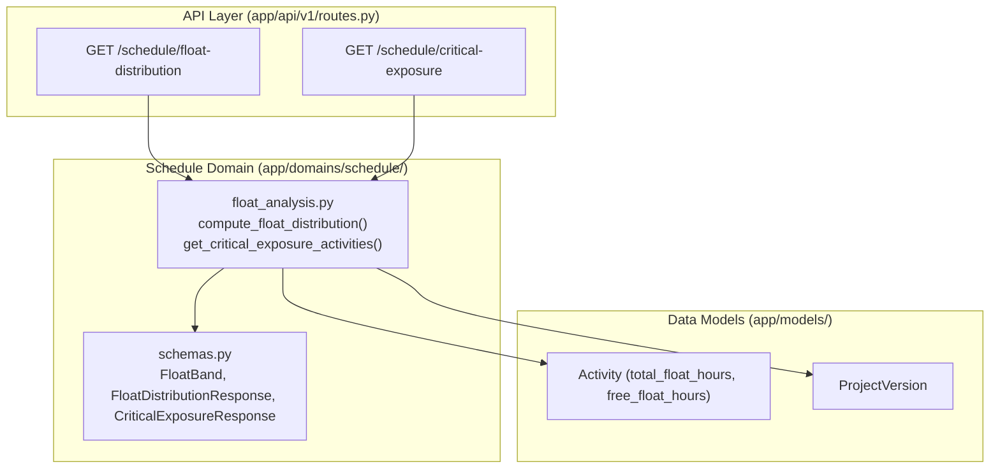

# PI-032 — Float and Critical Exposure Analysis Implementation Plan

> **For agentic workers:** REQUIRED SUB-SKILL: Use superpowers:subagent-driven-development to implement this plan task-by-task. Steps use checkbox (`- [ ]`) syntax for tracking.

**Goal:** Provide deterministic float band classification and critical exposure analytics for project schedules with configurable thresholds, unit conversion (hours vs days), separation of negative, zero, near-critical, and missing float, and clear labeling of imported source float.

**Architecture:** Implement a dedicated deterministic service in `backend/app/domains/schedule/float_analysis.py` decoupled from HTTP layers. Provide Pydantic schemas in `backend/app/domains/schedule/schemas.py` for float distributions, band metrics, and critical exposure activity rows. Expose through `/api/v1/projects/{project_id}/schedule/float-distribution` and `/api/v1/projects/{project_id}/schedule/critical-exposure` with tenant authorization guards, and integrate typed TypeScript client methods in the frontend.

**Architecture Diagram:**

**Tech Stack:** Python 3.11, FastAPI, SQLAlchemy 2.0 (async), Pydantic v2, TypeScript 5, Next.js 16.

**Spec:** `08_DEVELOPMENT_BACKLOG.md` (PI-032), `01_PRD.md`, `02_SYSTEM_ARCHITECTURE.md`, `05_AI_AGENT_SPEC.md`, `06_API_SPEC.md`.

---

## Global Constraints

- Domain isolation: `domains/schedule/` must NOT import `fastapi`, `starlette`, `openai`, `app.adapters`, `app.api`, `ingestion`, or `ai`.
- AI never computes float metrics directly; only deterministic Python calculations are used.
- Missing float is tracked as `None` / `missing` band, never coerced to `0` or `0.0`.
- Imported float values are explicitly labeled with `float_source: "imported_source"` and documented method.
- Unit conversion must default to standard 8.0 hours/day and convert safely without loss of precision.

---

### Task 1: Domain Schemas and Deterministic Float Analysis Engine

**Files:**
- Create: `backend/app/domains/schedule/float_analysis.py`
- Modify: `backend/app/domains/schedule/schemas.py`
- Test: `backend/tests/test_float_analysis_service.py`

**Interfaces:**
- Consumes: `Activity`, `ProjectVersion`, `Project` models from `app.models`.
- Produces: `compute_float_distribution`, `get_critical_exposure_activities`, `FloatDistributionResponse`, `CriticalExposureResponse`.

- [ ] **Step 1: Write failing unit tests for float distribution & critical exposure in `test_float_analysis_service.py`**
  - Test negative float separation (`< 0h`).
  - Test zero float separation (`== 0h`).
  - Test near-critical band (`0h < tf <= near_critical_threshold`).
  - Test missing float activities (null float is in `missing` band, total count matches).
  - Test unit conversion between hours and days (8h/day default or custom).
  - Test explicit `float_source: "imported_source"` and method disclosure.
- [ ] **Step 2: Add Pydantic schemas in `backend/app/domains/schedule/schemas.py`**
  - Define `FloatBandSummary` (name, label, min_hours, max_hours, count, percentage).
  - Define `FloatDistributionResponse` (project_id, version_id, float_source, method, critical_threshold_hours, near_critical_threshold_hours, hours_per_day, bands, min_float_hours, max_float_hours, total_activities, activities_with_float, activities_missing_float).
  - Define `CriticalExposureItem` (id, source_activity_id, activity_code, activity_name, status, total_float_hours, total_float_days, free_float_hours, free_float_days, start_date, finish_date, float_band, is_critical).
  - Define `CriticalExposureResponse` (project_id, version_id, float_source, method, critical_threshold_hours, near_critical_threshold_hours, hours_per_day, total_exposed, items, limit, offset).
- [ ] **Step 3: Implement domain logic in `backend/app/domains/schedule/float_analysis.py`**
  - Implement `compute_float_distribution(session, project_id, version_id=None, critical_threshold_hours=0.0, near_critical_threshold_hours=80.0, hours_per_day=8.0)`.
  - Implement `get_critical_exposure_activities(session, project_id, version_id=None, band=None, critical_threshold_hours=0.0, near_critical_threshold_hours=80.0, hours_per_day=8.0, limit=50, offset=0)`.
- [ ] **Step 4: Run pytest on domain service**
  - `uv run pytest tests/test_float_analysis_service.py`
  - Verify all domain service tests pass.

---

### Task 2: REST API Endpoints with Tenant Authorization Guard

**Files:**
- Modify: `backend/app/api/v1/routes.py`
- Test: `backend/tests/test_float_analysis.py`

**Interfaces:**
- Consumes: `compute_float_distribution` and `get_critical_exposure_activities` from `app.domains.schedule.float_analysis`.
- Produces:
  - `GET /api/v1/projects/{project_id}/schedule/float-distribution`
  - `GET /api/v1/projects/{project_id}/schedule/critical-exposure`

- [ ] **Step 1: Write failing integration tests in `backend/tests/test_float_analysis.py`**
  - Test `GET /float-distribution` returns HTTP 200 with bands, counts, and `float_source: "imported_source"`.
  - Test configurable thresholds (`critical_threshold_hours=-8.0`, `near_critical_threshold_hours=40.0`).
  - Test `GET /critical-exposure` filters by band (`negative`, `zero`, `near_critical`, `all_exposed`).
  - Test cross-tenant isolation (user from another workspace receives HTTP 404).
  - Test architecture isolation (`test_architecture.py` must stay 100% green).
- [ ] **Step 2: Add API routes in `backend/app/api/v1/routes.py`**
  - Add `GET /projects/{project_id}/schedule/float-distribution`.
  - Add `GET /projects/{project_id}/schedule/critical-exposure`.
  - Apply `ProjectAccess` tenant guard.
- [ ] **Step 3: Run pytest on integration tests**
  - `uv run pytest tests/test_float_analysis.py`

---

### Task 3: Frontend API Client & Type Definitions

**Files:**
- Modify: `frontend/src/lib/api-client.ts`
- Modify: `frontend/src/lib/api-client.test.ts`

**Interfaces:**
- Consumes: backend responses from `/schedule/float-distribution` and `/schedule/critical-exposure`.
- Produces: `getFloatDistribution()`, `getCriticalExposure()` typed functions.

- [ ] **Step 1: Add types and client methods in `frontend/src/lib/api-client.ts`**
  - Add `FloatBandSummary`, `FloatDistributionResponse`, `CriticalExposureItem`, `CriticalExposureResponse`.
  - Implement `getFloatDistribution(projectId, params)` and `getCriticalExposure(projectId, params)`.
- [ ] **Step 2: Add unit tests in `frontend/src/lib/api-client.test.ts`**
  - Test fetching float distribution with query params.
  - Test fetching critical exposure list.
- [ ] **Step 3: Run frontend tests**
  - `npm --prefix frontend test`

---

### Task 4: Full Monorepo Verification

- [ ] **Step 1: Run code quality checks**
  - `npm run check` (runs backend ruff, format check, mypy 78+ files, 115+ pytest tests; frontend lint, tsc, and node tests).
- [ ] **Step 2: Run frontend production build**
  - `npm --prefix frontend run build`

