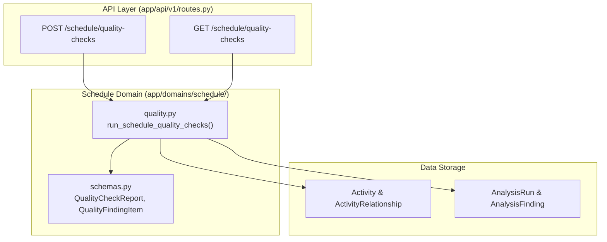

# PI-033 — Schedule Quality Checks v1 Implementation Plan

> **For agentic workers:** REQUIRED SUB-SKILL: Use superpowers:subagent-driven-development to implement this plan task-by-task. Steps use checkbox (`- [ ]`) syntax for tracking.

**Goal:** Implement deterministic schedule quality checks that audit project schedule integrity and performance, strictly distinguishing data-quality issues from schedule-performance findings, with full severity, method, evidence, and limitation disclosures on each finding.

**Architecture:** Create `backend/app/domains/schedule/quality.py` for pure domain check rules, schemas in `backend/app/domains/schedule/schemas.py`, and endpoint routes in `backend/app/api/v1/routes.py` with `ProjectAccess` tenant guard. Results persist to `AnalysisRun` and `AnalysisFinding` for auditability and are exposed via `POST` and `GET /api/v1/projects/{project_id}/schedule/quality-checks`.

**Architecture Diagram:**

**Tech Stack:** Python 3.11, SQLAlchemy 2.0 (async), Pydantic v2, FastAPI, TypeScript 5, Next.js 16.

**Spec:** `08_DEVELOPMENT_BACKLOG.md` (PI-033), `01_PRD.md`, `02_SYSTEM_ARCHITECTURE.md`, `03_DATA_MODEL.md`, `06_API_SPEC.md`.

---

## Global Constraints

- Domain isolation: `domains/schedule/` must NOT import `fastapi`, `starlette`, `openai`, `app.adapters`, `app.api`, `ingestion`, or `ai`.
- Data-quality checks must be clearly separated from schedule-performance findings (`category = "data_quality"` vs `category = "schedule_performance"`).
- Every finding must document: `check_code`, `category`, `severity`, `method`, `evidence`, and `limitation`.
- Unsupported or out-of-scope DCMA checks must not be claimed; only explicitly implemented checks are run.

---

### Task 1: Quality Check Domain Engine & Schemas

**Files:**
- Create: `backend/app/domains/schedule/quality.py`
- Modify: `backend/app/domains/schedule/schemas.py`
- Test: `backend/tests/test_schedule_quality_service.py`

**Interfaces:**
- Consumes: `Activity`, `ActivityRelationship`, `Project`, `ProjectVersion`, `AnalysisRun`, `AnalysisFinding`.
- Produces: `run_schedule_quality_checks`, `QualityCheckReport`, `QualityFindingItem`.

- [ ] **Step 1: Write failing unit tests in `test_schedule_quality_service.py`**
  - Test missing activity ID/code detection (`data_quality`).
  - Test duplicate activity code detection (`data_quality`).
  - Test orphan relationship detection (`data_quality`).
  - Test invalid date range detection (`data_quality`).
  - Test open start (missing predecessors) and open finish (missing successors), verifying start/finish milestones are properly excluded (`data_quality`).
  - Test negative float and high float detection (`schedule_performance`).
  - Verify every finding has `category`, `severity`, `method`, `evidence`, and `limitation`.
  - Verify persistence to `AnalysisRun` and `AnalysisFinding`.
- [ ] **Step 2: Add Pydantic schemas in `backend/app/domains/schedule/schemas.py`**
  - Define `QualityFindingItem` (id, check_code, category, title, severity, method, limitation, entity_type, entity_id, entity_source_id, entity_code, message, evidence).
  - Define `QualityCheckSummary` (total_findings, data_quality_count, schedule_performance_count, by_severity, checks_run).
  - Define `QualityCheckReport` (project_id, version_id, run_id, data_date, summary, findings).
  - Define `RunQualityChecksRequest` (version_id, selected_checks, persist).
- [ ] **Step 3: Implement domain check rules in `backend/app/domains/schedule/quality.py`**
  - Implement checks for:
    1. `missing_activity_identifier`
    2. `duplicate_activity_identifier`
    3. `orphan_relationships`
    4. `invalid_date_range`
    5. `missing_predecessors` (excluding start milestones)
    6. `missing_successors` (excluding finish milestones)
    7. `invalid_progress` (percentages < 0 or > 100)
    8. `negative_float` (total_float_hours < 0)
    9. `high_float` (total_float_hours > threshold, default 352h / 44 days)
  - Implement `run_schedule_quality_checks(...)` with optional persistence to `AnalysisRun` / `AnalysisFinding`.
- [ ] **Step 4: Run pytest on domain service**
  - `cd backend; uv run pytest tests/test_schedule_quality_service.py`

---

### Task 2: REST API Endpoints with Tenant Authorization Guard

**Files:**
- Modify: `backend/app/api/v1/routes.py`
- Test: `backend/tests/test_schedule_quality.py`

**Interfaces:**
- Consumes: `run_schedule_quality_checks` from `app.domains.schedule.quality`.
- Produces:
  - `POST /api/v1/projects/{project_id}/schedule/quality-checks`
  - `GET /api/v1/projects/{project_id}/schedule/quality-checks`

- [ ] **Step 1: Write integration tests in `backend/tests/test_schedule_quality.py`**
  - Test POST runs quality checks on confirmed version.
  - Test GET retrieves checks for latest or specified version.
  - Test filtering checks by category (`data_quality` vs `schedule_performance`).
  - Test tenant isolation (other tenant receives HTTP 404).
  - Test architecture isolation (`test_architecture.py` must stay 100% green).
- [ ] **Step 2: Add API routes in `backend/app/api/v1/routes.py`**
  - Add POST and GET routes with `ProjectAccess` tenant guard.
- [ ] **Step 3: Run pytest on integration tests**
  - `cd backend; uv run pytest tests/test_schedule_quality.py`

---

### Task 3: Frontend API Client & Type Definitions

**Files:**
- Modify: `frontend/src/lib/api-client.ts`
- Modify: `frontend/src/lib/api-client.test.ts`

**Interfaces:**
- Consumes: backend responses from `/schedule/quality-checks`.
- Produces: `runQualityChecks()`, `getQualityChecks()` typed client methods.

- [ ] **Step 1: Add types and client methods in `frontend/src/lib/api-client.ts`**
  - Add `QualityFindingItem`, `QualityCheckSummary`, `QualityCheckReport`, `RunQualityChecksRequest`.
  - Implement `apiClient.runQualityChecks` and `apiClient.getQualityChecks`.
- [ ] **Step 2: Add unit tests in `frontend/src/lib/api-client.test.ts`**
  - Test invoking `runQualityChecks` and validating separated counts and finding structure.
- [ ] **Step 3: Run frontend tests**
  - `npm --prefix frontend test`

---

### Task 4: Full Monorepo Verification

- [ ] **Step 1: Run code quality checks**
  - `npm run check` (backend ruff, format check, mypy 82+ files, 125+ pytest tests; frontend lint, tsc, and node tests).
- [ ] **Step 2: Run frontend production build**
  - `npm --prefix frontend run build`

