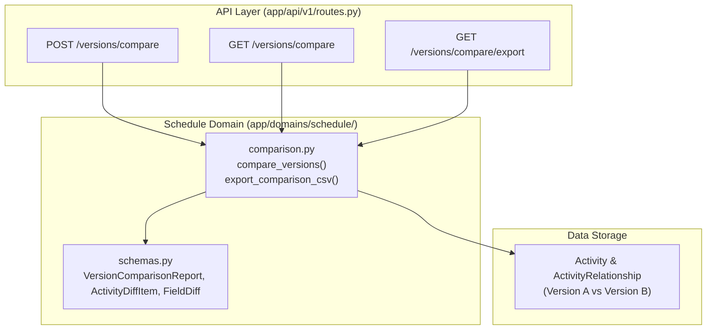

# PI-034 — Version Comparison Engine Implementation Plan

> **For agentic workers:** REQUIRED SUB-SKILL: Use superpowers:subagent-driven-development to implement this plan task-by-task. Steps use checkbox (`- [ ]`) syntax for tracking.

**Goal:** Implement a deterministic version comparison engine that compares two confirmed schedule versions, matching activities by stable source ID first, activity code second, separating ambiguous matches, reconciling added/removed/changed/unchanged counts, and exporting field and relationship changes.

**Architecture:** Create `backend/app/domains/schedule/comparison.py` decoupled from HTTP layers. Provide schemas in `backend/app/domains/schedule/schemas.py`. Expose via `POST /api/v1/projects/{project_id}/versions/compare` and `GET /api/v1/projects/{project_id}/versions/compare` (plus export support). Enforce tenant boundary via `ProjectAccess`. Provide typed client methods in frontend `api-client.ts`.

**Architecture Diagram:**

**Tech Stack:** Python 3.11, SQLAlchemy 2.0 (async), Pydantic v2, FastAPI, TypeScript 5, Next.js 16.

**Spec:** `08_DEVELOPMENT_BACKLOG.md` (PI-034), `01_PRD.md`, `02_SYSTEM_ARCHITECTURE.md`, `03_DATA_MODEL.md`, `05_AI_AGENT_SPEC.md`, `06_API_SPEC.md`, `07_UI_UX_SPEC.md`.

---

## Global Constraints

- Domain isolation: `domains/schedule/` must NOT import `fastapi`, `starlette`, `openai`, `app.adapters`, `app.api`, `ingestion`, or `ai`.
- Matching rule: Stable P6 source ID first, activity code second. Never match solely on activity name.
- Ambiguous matches (duplicate codes in either version) must be isolated into `ambiguous_match`, not guess-matched.
- Exact reconciliation: `from_version_total == matched + removed + ambiguous_from` and `to_version_total == matched + added + ambiguous_to`.
- Unavailable or null field values in diffs must be rendered as `None`, not coerced to `0` or `0.0`.

---

### Task 1: Comparison Domain Engine & Schemas

**Files:**
- Create: `backend/app/domains/schedule/comparison.py`
- Modify: `backend/app/domains/schedule/schemas.py`
- Test: `backend/tests/test_version_comparison_service.py`

**Interfaces:**
- Consumes: `Activity`, `ActivityRelationship`, `Project`, `ProjectVersion`.
- Produces: `compare_versions`, `export_comparison_csv`, `VersionComparisonReport`, `ActivityDiffItem`, `FieldDiff`.

- [x] **Step 1: Write failing unit tests in `test_version_comparison_service.py`**
  - Test matching by `source_activity_id`.
  - Test matching by `activity_code` when source ID is unavailable.
  - Test separation of ambiguous matches (duplicate codes in either version).
  - Test added activities (in B only).
  - Test removed activities (in A only).
  - Test changed activities with field diffs (dates, duration, float, status, progress, relationships).
  - Test unchanged activities.
  - Verify count reconciliation invariant.
  - Test CSV export generation of diffs.
- [x] **Step 2: Add Pydantic schemas in `backend/app/domains/schedule/schemas.py`**
  - Define `FieldDiff` (field_name, old_value, new_value, delta).
  - Define `RelationshipDiff` (relationship_type, other_activity_code, other_activity_name, change_type).
  - Define `ActivityDiffItem` (diff_category, activity_code, activity_name, source_activity_id, match_key, from_activity_id, to_activity_id, field_changes, relationship_changes, ambiguous_reason).
  - Define `ComparisonSummary` (from_version_total, to_version_total, added, removed, changed, unchanged, ambiguous, change_categories).
  - Define `VersionComparisonReport` (project_id, from_version_id, to_version_id, from_version_number, to_version_number, from_data_date, to_data_date, summary, items, total_items, limit, offset).
  - Define `CompareVersionsRequest` (from_version_id, to_version_id, fields, category_filter, limit, offset).
- [x] **Step 3: Implement domain logic in `backend/app/domains/schedule/comparison.py`**
  - Implement two-stage matching (source ID -> activity code -> ambiguous isolation).
  - Implement field diffing with delta calculation.
  - Implement relationship graph diffing.
  - Implement reconciliation counting.
  - Implement `export_comparison_csv(report)`.
- [x] **Step 4: Run pytest on domain service**
  - `cd backend; uv run pytest tests/test_version_comparison_service.py`

---

### Task 2: REST API Endpoints with Tenant Authorization Guard

**Files:**
- Modify: `backend/app/api/v1/routes.py`
- Test: `backend/tests/test_version_comparison.py`

**Interfaces:**
- Consumes: `compare_versions`, `export_comparison_csv` from `app.domains.schedule.comparison`.
- Produces:
  - `POST /api/v1/projects/{project_id}/versions/compare`
  - `GET /api/v1/projects/{project_id}/versions/compare`
  - `GET /api/v1/projects/{project_id}/versions/compare/export`

- [x] **Step 1: Write integration tests in `backend/tests/test_version_comparison.py`**
  - Test comparing version 1 and version 2 returns accurate added/removed/changed/unchanged diffs.
  - Test filter by `diff_category` (`added`, `changed`, etc.).
  - Test export endpoint returns `text/csv`.
  - Test cross-tenant isolation (HTTP 404).
  - Test architecture isolation (`test_architecture.py` must stay 100% green).
- [x] **Step 2: Add API routes in `backend/app/api/v1/routes.py`**
  - Add POST, GET, and export routes with `ProjectAccess` tenant guard.
- [x] **Step 3: Run pytest on integration tests**
  - `cd backend; uv run pytest tests/test_version_comparison.py`

---

### Task 3: Frontend API Client & Type Definitions

**Files:**
- Modify: `frontend/src/lib/api-client.ts`
- Modify: `frontend/src/lib/api-client.test.ts`

**Interfaces:**
- Consumes: backend responses from `/versions/compare`.
- Produces: `compareVersions()`, `getComparisonReport()`, `exportComparisonCsv()` typed client methods.

- [x] **Step 1: Add types and client methods in `frontend/src/lib/api-client.ts`**
  - Add comparison types and query parameters.
  - Implement `compareVersions` and `getComparisonReport`.
- [x] **Step 2: Add unit tests in `frontend/src/lib/api-client.test.ts`**
  - Test calling `compareVersions` and validating reconciliation counts and field diffs.
- [x] **Step 3: Run frontend tests**
  - `npm --prefix frontend test`

---

### Task 4: Full Monorepo Verification

- [x] **Step 1: Run code quality checks**
  - `npm run check` (backend ruff, format check, mypy 85+ files, 130+ pytest tests; frontend lint, tsc, and node tests).
- [x] **Step 2: Run frontend production build**
  - `npm --prefix frontend run build`

