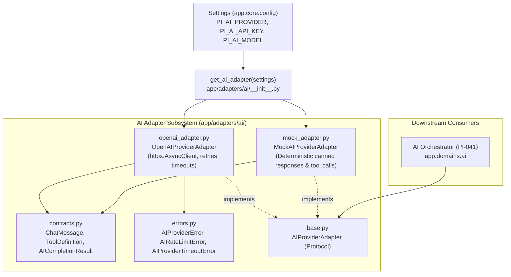

# PI-040 — AI Provider Adapter Implementation Plan

> **For agentic workers:** REQUIRED SUB-SKILL: Use superpowers:subagent-driven-development to implement this plan task-by-task. Steps use checkbox (`- [ ]`) syntax for tracking.

**Goal:** Implement a secure, robust, and configurable AI Provider Adapter supporting OpenAI-compatible chat completions and tool calling, complete with deterministic mock capabilities, exponential backoff retries, timeouts, and sanitized metadata logging.

**Architecture:** Create `backend/app/adapters/ai/` decoupled from web routers and domain logic. Define protocol `AIProviderAdapter` in `base.py`, data contracts in `contracts.py`, and error types in `errors.py`. Implement `OpenAIProviderAdapter` using `httpx.AsyncClient` and `MockAIProviderAdapter` for deterministic local development and CI testing. Expose factory `get_ai_adapter(settings)`. Ensure all prompts and raw payloads are strictly redacted from structured logs.

**Architecture Diagram:**

**Tech Stack:** Python 3.11, Pydantic v2, HTTPX, Structlog / Standard Logging, Pytest (asyncio).

**Spec:** `08_DEVELOPMENT_BACKLOG.md` (PI-040), `01_PRD.md`, `02_SYSTEM_ARCHITECTURE.md`, `05_AI_AGENT_SPEC.md`.

---

## Global Constraints

- Domain isolation: Domain services (`app/domains/ai/`, `app/domains/schedule/`) must NOT import external vendor SDKs directly; all LLM communication must route through the adapter interface.
- Secret safety: AI API keys must be wrapped in `SecretStr` and never serialized into logs, strings, or error traces.
- Privacy & Redaction: Request/response metadata (model, tokens, latency, status) may be logged, but raw prompt text, system prompts, and project activity payloads must be redacted.
- Provider configurability: Provider name (`mock`, `openai`) and model (`gpt-4o`, etc.) must be configurable via environment variables (`PI_AI_PROVIDER`, `PI_AI_MODEL`).
- Resiliency: Transient 429 (rate limit) and 5xx errors must be retried with exponential backoff and jitter up to `max_retries`. Non-retryable 4xx errors must fail fast with clear typed exceptions.

---

### Task 1: AI Provider Settings and Data Contracts

**Files:**
- Modify: `backend/app/core/config.py`
- Create: `backend/app/adapters/ai/contracts.py`
- Create: `backend/app/adapters/ai/errors.py`
- Test: `backend/tests/test_ai_adapter_contracts.py`

**Interfaces:**
- Consumes: `pydantic.BaseModel`, `pydantic.SecretStr`, `Settings`.
- Produces: `ChatMessage`, `ToolDefinition`, `ToolCallItem`, `AICompletionResult`, `AIUsageMetadata`, `AIProviderError`, `AIRateLimitError`, `AIProviderTimeoutError`, `AIAuthenticationError`.

- [x] **Step 1: Write failing unit test in `test_ai_adapter_contracts.py`**
  - Test `Settings` loading of AI configurations (`PI_AI_PROVIDER`, `PI_AI_MODEL`, `PI_AI_API_KEY`, etc.).
  - Test serialization of `ChatMessage`, `ToolDefinition`, and `AICompletionResult`.
  - Test that `SecretStr` does not leak plaintext in string representations.
  - Test error class hierarchy and message encapsulation.
- [x] **Step 2: Update `backend/app/core/config.py`**
  - Add fields:
    - `ai_provider: str = "mock"`
    - `ai_model: str = "gpt-4o"`
    - `ai_api_key: SecretStr | None = None`
    - `ai_base_url: str | None = None`
    - `ai_timeout_seconds: float = Field(default=30.0, gt=0, le=120)`
    - `ai_max_retries: int = Field(default=3, ge=0, le=10)`
- [x] **Step 3: Create `backend/app/adapters/ai/contracts.py`**
  - Define `Role = Literal["system", "developer", "user", "assistant", "tool"]`.
  - Define `ChatMessage(role, content, name=None, tool_call_id=None)`.
  - Define `ToolCallFunction(name, arguments)`.
  - Define `ToolCallItem(id, type="function", function)`.
  - Define `ToolDefinition(type="function", function={"name": ..., "description": ..., "parameters": ...})`.
  - Define `AIUsageMetadata(prompt_tokens, completion_tokens, total_tokens)`.
  - Define `AICompletionResult(message, tool_calls, usage, model, provider, latency_ms)`.
- [x] **Step 4: Create `backend/app/adapters/ai/errors.py`**
  - Base class: `AIProviderError(Exception)`.
  - Subclasses: `AIAuthenticationError`, `AIRateLimitError`, `AIProviderTimeoutError`, `AIInvalidRequestError`.
- [x] **Step 5: Run tests on contracts and settings**
  - `cd backend; uv run pytest tests/test_ai_adapter_contracts.py`

---

### Task 2: AI Provider Adapter Interface and Implementations (Mock & OpenAI)

**Files:**
- Create: `backend/app/adapters/ai/base.py`
- Create: `backend/app/adapters/ai/mock_adapter.py`
- Create: `backend/app/adapters/ai/openai_adapter.py`
- Create: `backend/app/adapters/ai/__init__.py`
- Test: `backend/tests/test_ai_provider_adapter.py`

**Interfaces:**
- Consumes: `contracts.py`, `errors.py`, `Settings`.
- Produces: `AIProviderAdapter` (Protocol), `MockAIProviderAdapter`, `OpenAIProviderAdapter`, `get_ai_adapter(settings)`.

- [x] **Step 1: Write failing unit test in `test_ai_provider_adapter.py`**
  - Test `MockAIProviderAdapter` with predefined textual completion.
  - Test `MockAIProviderAdapter` with predefined tool call response.
  - Test `MockAIProviderAdapter` recording sent message history.
  - Test `OpenAIProviderAdapter` formatting requests, parsing assistant responses, and extracting tool calls.
  - Test `OpenAIProviderAdapter` retrying on 429 / 503 and failing fast on 401 / 400.
  - Test `OpenAIProviderAdapter` raising `AIProviderTimeoutError` on timeout.
  - Test adapter factory `get_ai_adapter(settings)` choosing `MockAIProviderAdapter` or `OpenAIProviderAdapter`.
- [x] **Step 2: Create `backend/app/adapters/ai/base.py`**
  - Define `AIProviderAdapter` abstract protocol with async method `complete(messages, tools=None, temperature=0.0, ...) -> AICompletionResult`.
- [x] **Step 3: Create `backend/app/adapters/ai/mock_adapter.py`**
  - Implement `MockAIProviderAdapter`:
    - Stores `call_history`.
    - Supports queue of canned responses (`queue_response`, `queue_tool_call`).
    - Supports simulated latency and error triggers.
- [x] **Step 4: Create `backend/app/adapters/ai/openai_adapter.py`**
  - Implement `OpenAIProviderAdapter`:
    - Wraps async `httpx.AsyncClient`.
    - Handles base URL fallback (`https://api.openai.com/v1`).
    - Maps payloads to OpenAI `/chat/completions` specification.
    - Implements exponential backoff loop with jitter for transient errors (429, 500, 502, 503, 504).
    - Maps HTTP status codes to typed exceptions (`AIAuthenticationError` for 401/403, `AIRateLimitError` for 429, etc.).
- [x] **Step 5: Create `backend/app/adapters/ai/__init__.py`**
  - Implement cached factory `get_ai_adapter(settings: Settings) -> AIProviderAdapter`.
- [x] **Step 6: Run adapter unit tests**
  - `cd backend; uv run pytest tests/test_ai_provider_adapter.py`

---

### Task 3: Metadata Logging & Security Redaction Verification

**Files:**
- Create: `backend/app/adapters/ai/telemetry.py`
- Test: `backend/tests/test_ai_logging_redaction.py`

**Interfaces:**
- Consumes: `AICompletionResult`, `Settings`.
- Produces: `log_ai_completion_metadata(result, duration_ms)`.

- [x] **Step 1: Write failing test in `test_ai_logging_redaction.py`**
  - Test that logger receives structured dict containing `provider`, `model`, `latency_ms`, `token_input`, `token_output`, `status`.
  - Assert that sensitive prompt content, user messages, and tool response payloads do NOT appear in the log output.
- [x] **Step 2: Implement `backend/app/adapters/ai/telemetry.py`**
  - Create structured logging helper that emits only sanitized metadata.
- [x] **Step 3: Integrate telemetry helper into adapters**
- [x] **Step 4: Run telemetry tests**
  - `cd backend; uv run pytest tests/test_ai_logging_redaction.py`

---

### Task 4: Full Monorepo & Architecture Verification

- [x] **Step 1: Verify architectural boundaries**
  - Run `cd backend; uv run pytest tests/test_architecture.py`. Ensure domain modules remain completely isolated.
- [x] **Step 2: Run full monorepo check**
  - `npm run check` (verify all backend tests, mypy, ruff lint/format, and frontend tests pass).

