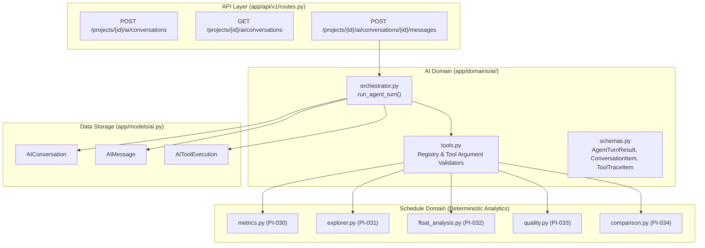

# PI-041 — Project AI Orchestrator Implementation Plan

> **For agentic workers:** REQUIRED SUB-SKILL: Use superpowers:subagent-driven-development to implement this plan task-by-task. Steps use checkbox (`- [ ]`) syntax for tracking.

**Goal:** Implement a server-controlled Project AI Orchestrator that routes user queries to validated schedule analytics tools, strictly prevents tenant or project context tampering, executes multi-turn tool-calling loops, and records complete conversation and tool execution history.

**Architecture:** Create `backend/app/domains/ai/` decoupled from web frameworks and vendor adapters. Define tool registry in `tools.py` with strict Pydantic argument schemas wrapping schedule domain functions (PI-030 to PI-034). Define multi-turn orchestrator in `orchestrator.py` that binds authenticated server context (`project_id`, `version_id`, `workspace_id`) and executes the model request-execute-response cycle. Persist traces to `AIConversation`, `AIMessage`, and `AIToolExecution`. Expose endpoints via `routes.py` with `ProjectAccess` tenant guard.

**Architecture Diagram:**

**Tech Stack:** Python 3.11, SQLAlchemy 2.0 (async), Pydantic v2, FastAPI, TypeScript 5.

**Spec:** `08_DEVELOPMENT_BACKLOG.md` (PI-041), `01_PRD.md`, `02_SYSTEM_ARCHITECTURE.md`, `05_AI_AGENT_SPEC.md`, `06_API_SPEC.md`.

---

## Global Constraints

- Domain isolation: `domains/ai/` must NOT import `fastapi`, `starlette`, `openai`, `app.adapters`, or `app.api` (strictly verified by `test_architecture.py`).
- Zero-Trust LLM Parameters: Model cannot supply or override `workspace_id`, `project_id`, or target `project_version_id`. All tenant context is strictly injected by the server.
- No direct metric calculations: LLM must not compute or invent schedule metrics; it must invoke approved deterministic schedule tools.
- Audit & Observability: Every tool invocation must record execution status (`completed`, `failed`), arguments, execution latency (`duration_ms`), and output summary in `AIToolExecution`.
- Multi-tenant isolation: All conversation queries must be scoped to the authenticated project and workspace (`ProjectAccess`).

---

### Task 1: AI Tool Registry and Argument Validators

**Files:**
- Create: `backend/app/domains/ai/schemas.py`
- Create: `backend/app/domains/ai/tools.py`
- Test: `backend/tests/test_ai_tool_registry.py`

**Interfaces:**
- Consumes: schedule functions (`compute_project_overview_metrics`, `list_activities`, `get_activity_detail`, `get_activity_relationships`, `get_critical_exposure_activities`, `compute_float_distribution`, `run_schedule_quality_checks`, `compare_versions`).
- Produces: `AIToolRegistry`, `ToolDefinition` list, tool execution dispatcher `execute_tool(session, project_id, version_id, name, arguments)`.

- [x] **Step 1: Write failing unit tests in `test_ai_tool_registry.py`**
  - Test tool definitions match OpenAI function calling schema spec.
  - Test server-side parameter validation (validating required types, bounds, rejecting malformed arguments).
  - Test that model cannot override `project_id` or `version_id` (server context always takes precedence).
  - Test executing each approved tool (`get_project_overview`, `list_activities`, `get_critical_activities`, `get_float_distribution`, `analyze_schedule_quality`, `compare_project_versions`).
  - Test tool failure handling and error summary encapsulation.
- [x] **Step 2: Define schemas in `backend/app/domains/ai/schemas.py`**
  - Define tool argument Pydantic models:
    - `GetOverviewArgs`, `ListActivitiesArgs`, `GetActivityDetailArgs`, `GetRelationshipsArgs`, `GetCriticalActivitiesArgs`, `GetFloatDistributionArgs`, `AnalyzeQualityArgs`, `CompareVersionsArgs`.
  - Define `ToolExecutionResult(status, tool_name, summary, data, evidence_refs, duration_ms, error)`.
  - Define conversation request/response schemas:
    - `CreateConversationRequest`, `ConversationResponse`, `SendMessageRequest`, `AgentTurnResponse`, `ToolExecutionItem`.
- [x] **Step 3: Implement `backend/app/domains/ai/tools.py`**
  - Build `TOOL_DEFINITIONS` list with strict schemas.
  - Implement `execute_tool()` that routes tool calls to underlying schedule domain functions with server-injected project/version context.
  - Return standardized `ToolExecutionResult`.
- [x] **Step 4: Run unit tests on tool registry**
  - `cd backend; uv run pytest tests/test_ai_tool_registry.py`

---

### Task 2: Project AI Orchestrator Core

**Files:**
- Create: `backend/app/domains/ai/orchestrator.py`
- Test: `backend/tests/test_ai_orchestrator.py`

**Interfaces:**
- Consumes: `tools.py`, `schemas.py`, `app.models.ai` (`AIConversation`, `AIMessage`, `AIToolExecution`), `ProjectVersion`.
- Produces: `create_conversation()`, `get_conversation()`, `run_agent_turn()`.

- [x] **Step 1: Write failing unit tests in `test_ai_orchestrator.py`**
  - Test multi-turn loop: LLM decides to call tool -> tool executes -> LLM produces final response.
  - Test server-context binding: default to latest ready version if version not specified.
  - Test persistence: conversation, user message, tool executions, and assistant message saved to database.
  - Test error handling: tool failure gracefully conveyed back to LLM to produce an informative answer.
  - Test maximum turn safeguard (prevents infinite tool loops).
- [x] **Step 2: Implement orchestrator in `backend/app/domains/ai/orchestrator.py`**
  - Implement `SYSTEM_PROMPT` containing instructions from `05_AI_AGENT_SPEC.md`.
  - Implement conversation management: `create_conversation()`, `list_conversations()`, `get_conversation()`.
  - Implement `run_agent_turn()` multi-turn cycle:
    1. Resolve target version (explicit or `latest_version_id`).
    2. Load previous messages from conversation history.
    3. Persist incoming user message.
    4. Call LLM protocol with messages and tool definitions.
    5. Handle tool call loop (execute tool via `tools.py`, persist `AIToolExecution`, append tool response message, call LLM again).
    6. Persist final assistant message and return `AgentTurnResponse`.
- [x] **Step 3: Run orchestrator unit tests**
  - `cd backend; uv run pytest tests/test_ai_orchestrator.py`

---

### Task 3: REST API Endpoints with Tenant Authorization Guard

**Files:**
- Modify: `backend/app/api/v1/routes.py`
- Test: `backend/tests/test_ai_routes.py`

**Interfaces:**
- Consumes: `orchestrator.py`, `get_ai_adapter(settings)`, `ProjectAccess`.
- Produces:
  - `POST /api/v1/projects/{project_id}/ai/conversations`
  - `GET /api/v1/projects/{project_id}/ai/conversations`
  - `GET /api/v1/projects/{project_id}/ai/conversations/{conversation_id}`
  - `POST /api/v1/projects/{project_id}/ai/conversations/{conversation_id}/messages`

- [x] **Step 1: Write integration tests in `test_ai_routes.py`**
  - Test creating conversation and retrieving history.
  - Test sending a user message, triggering tool execution via mock adapter, and receiving assistant response.
  - Test tenant isolation: cross-tenant access to conversations returns 404.
  - Test architecture isolation (`test_architecture.py` must stay 100% green).
- [x] **Step 2: Add API routes in `backend/app/api/v1/routes.py`**
  - Add conversation and message endpoints protected by `ProjectAccess` tenant guard.
  - Inject AI adapter resolved via `get_ai_adapter(settings)`.
- [x] **Step 3: Run API integration tests**
  - `cd backend; uv run pytest tests/test_ai_routes.py`

---

### Task 4: Frontend API Client & Monorepo Verification

**Files:**
- Modify: `frontend/src/lib/api-client.ts`
- Modify: `frontend/src/lib/api-client.test.ts`

**Interfaces:**
- Consumes: AI endpoints.
- Produces: `createAIConversation()`, `listAIConversations()`, `getAIConversation()`, `sendAIMessage()` typed client methods.

- [x] **Step 1: Add types and client methods in `frontend/src/lib/api-client.ts`**
  - Add conversation and message types.
  - Implement client methods on `api` object.
- [x] **Step 2: Add unit tests in `frontend/src/lib/api-client.test.ts`**
  - Test calling AI endpoints and verifying payload contracts.
- [x] **Step 3: Run full monorepo check**
  - `npm run check` (verify 150+ backend tests, 31+ frontend tests, ruff, mypy, tsc, and lint).

