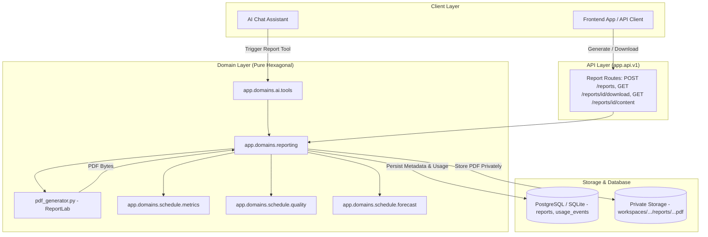

# PI-046 PDF Schedule Report Implementation Plan

> **For agentic workers:** REQUIRED SUB-SKILL: Use superpowers:subagent-driven-development to implement this plan task-by-task. Steps use checkbox (`- [ ]`) syntax for tracking.

**Goal:** Implement PI-046 PDF Schedule Report generation and authorized short-lived download, referencing exact project version and data date with executive overview, deterministic schedule quality metrics, milestone forecast projections, methodology notes, and explicit limitations.

**Architecture:** A domain-driven reporting engine (`backend/app/domains/reporting/`) generates structured PDF documents via `reportlab` using deterministic schedule metrics and quality checks without mutating source data. The binary PDF is saved to private storage via `StorageAdapter`. The REST API issues signed short-lived download tokens (`GET /reports/{report_id}/download`) and streams private PDF content (`GET /reports/{report_id}/content?token=...`). AI tool `generate_schedule_report` allows conversational report generation with evidence citations.

**Architecture Diagram:**

**Tech Stack:**

- Backend: Python 3.11, FastAPI, SQLAlchemy 2.0, Pydantic v2, ReportLab 5.1, PyJWT
- Storage: `StorageAdapter` (`LocalStorageAdapter` for local dev/test, S3-compatible private storage in production)
- Frontend: TypeScript, Next.js 16, Node.js test runner

**Spec References:**

- `01_PRD.md` Section 3 (Journey 4), FR-015, FR-016
- `02_SYSTEM_ARCHITECTURE.md` Section 10 (Object storage & Private bucket policies)
- `03_DATA_MODEL.md` (reports table, usage_events table)
- `05_AI_AGENT_SPEC.md` Section 3 (generate_schedule_report tool)
- `06_API_SPEC.md` Section 7 (Reports and exports endpoints)
- `07_UI_UX_SPEC.md` Section 4 (Reports screen)
- `08_DEVELOPMENT_BACKLOG.md` PI-046

---

## Global Constraints

1. **Architecture Isolation:**
   `backend/app/domains/reporting/` MUST NOT import `fastapi`, `starlette`, `openai`, `app.adapters`, or `app.api` (strictly verified by `tests/test_architecture.py`). Storage interaction is injected as a callable/protocol.
2. **Private Storage & Short-lived Access:**
   No public URLs or unrestricted filesystem access. Download URLs use signed JWT tokens with 15-minute expiration (`exp`).
3. **Data Integrity & Traceability:**
   Every report must explicitly bind to `project_version_id`, `data_date`, `created_at`, `project_name`, and `project_code`.
4. **Deterministic & Transparent:**
   All schedule metrics, quality checks, and milestone forecast dates must come from deterministic schedule engines with explicit methodology notes and limitations disclaimers.
5. **Usage Metering:**
   Each report generation must record a `usage_events` row with `event_type='report_export'`.

---

## Proposed Tasks

### Task 1: Reporting Domain Schemas & PDF Generator Engine

- **Files:**
  - `backend/app/domains/reporting/schemas.py`: Report request, response, token payload, and metadata models.
  - `backend/app/domains/reporting/pdf_generator.py`: ReportLab document builder creating professional multi-page EPC PDF with headers, overview, quality tables, milestone forecasts, and methodology disclaimers.
  - `backend/tests/test_reporting_pdf.py`: Unit tests for PDF generation, PDF header verification (`%PDF-`), and content assertion.

### Task 2: Reporting Core Service & Usage Metering

- **Files:**
  - `backend/app/domains/reporting/service.py`: Service to coordinate metric aggregation, PDF generation, storage persistence, `Report` database record updates, short-lived token signing/verification, and `UsageEvent` recording.
  - `backend/tests/test_reporting_service.py`: Unit tests verifying database status lifecycle (`generating` -> `ready`), storage upload, token issuance, and usage event recording.

### Task 3: REST API Endpoints with Tenant Authorization & Short-Lived Download

- **Files:**
  - `backend/app/api/v1/routes.py`:
    - `POST /projects/{project_id}/reports`: Request schedule report generation.
    - `GET /reports/{report_id}`: Fetch report status and metadata.
    - `GET /reports/{report_id}/download`: Obtain signed short-lived download URL.
    - `GET /reports/{report_id}/content`: Stream binary PDF with JWT token or Bearer authorization.
  - `backend/tests/test_reporting_routes.py`: Tests for generation, metadata inspection, token validation, download streaming, and tenant isolation.

### Task 4: AI Tool Registration & Evidence Tagging

- **Files:**
  - `backend/app/domains/ai/schemas.py`: Add `GenerateScheduleReportArgs`.
  - `backend/app/domains/ai/tools.py`: Register and execute `generate_schedule_report`.
  - `backend/app/domains/ai/evidence.py`: Format evidence citation `[EV: report/<report_id> (pdf)]`.
  - `backend/tests/test_ai_reporting_tool.py`: Unit tests for AI tool execution, argument validation, and evidence tagging.

### Task 5: Frontend API Client & Full Monorepo Verification

- **Files:**
  - `frontend/src/lib/api-client.ts`: Add `generateScheduleReport()`, `getReport()`, and `getReportDownloadUrl()`.
  - `frontend/src/lib/api-client.test.ts`: Unit tests for frontend client report operations.
- **Verification:**
  - `npm run check` (all backend pytest tests, frontend node tests, ruff, mypy, eslint, tsc)
  - `npm --prefix frontend run build` (Next.js production build)
