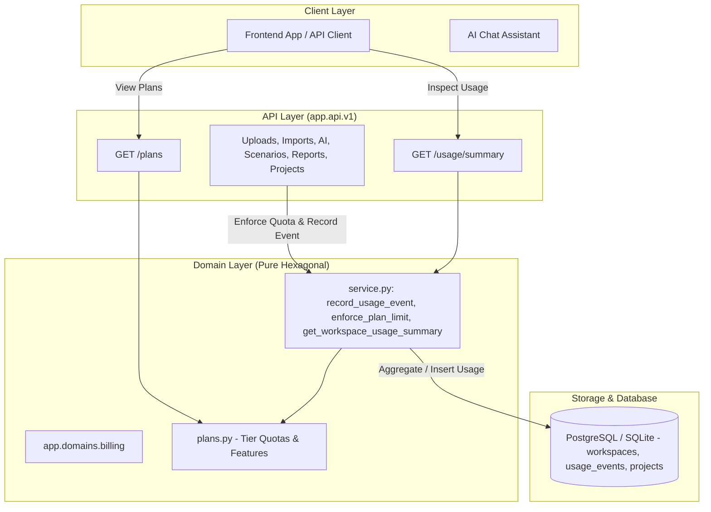

# PI-050 Usage Events and Plan Limits Implementation Plan

> **For agentic workers:** REQUIRED SUB-SKILL: Use superpowers:subagent-driven-development to implement this plan task-by-task. Steps use checkbox (`- [ ]`) syntax for tracking.

**Goal:** Implement PI-050 usage event tracking, server-side per-plan limit enforcement, and usage summary endpoints referencing billing period, active projects, file uploads, imports, AI queries, scenario runs, and report exports.

**Architecture:** A domain-driven billing & metering module (`backend/app/domains/billing/`) defines plan tiers and quotas (`plans.py`), exposes schemas for usage summaries and limits (`schemas.py`), records usage events, and enforces plan quotas (`service.py`) across all platform operations. REST API endpoints (`GET /api/v1/usage/summary` and `GET /api/v1/plans`) provide usage visibility to users and agents. Frontend client (`frontend/src/lib/api-client.ts`) provides typed access to plan information and usage summaries.

**Architecture Diagram:**

**Tech Stack:**
- Backend: Python 3.11, FastAPI, SQLAlchemy 2.0, Pydantic v2
- Frontend: TypeScript, Next.js 16, Node.js test runner

---

## Global Constraints

1. **Architecture Isolation:**
   `backend/app/domains/billing/` MUST NOT import `fastapi`, `starlette`, `openai`, `app.adapters`, or `app.api` (enforced by `tests/test_architecture.py`).
2. **Deterministic & Server-Side Enforcement:**
   Every billable platform operation MUST check limits on the server before execution; clients cannot bypass quotas.
3. **Multi-Tenant Scoping:**
   Usage events and summaries are strictly scoped to the authenticated user's workspace (`workspace_id`).
4. **Billing Period Consistency:**
   Standard monthly rolling or calendar cycle with explicit `billing_period_start`, `billing_period_end`, and `reset_date`.
5. **Clear Error Contract:**
   Limit violations raise `PlanLimitExceededError` translating to HTTP 403 or 429 with error code `PLAN_LIMIT_EXCEEDED` and actionable upgrade metadata.

---

## Proposed Tasks

### Task 1: Billing Domain Models & Quota Definitions
- [x] Create `backend/app/domains/billing/plans.py`: Define `PlanTier` dataclass / Enum (`free`, `pro`, `enterprise`) with quotas (`max_projects`, `max_file_uploads_per_month`, `max_imports_per_month`, `max_ai_queries_per_month`, `max_scenarios_per_month`, `max_reports_per_month`, `max_upload_size_bytes`).
- [x] Create `backend/app/domains/billing/schemas.py`: Pydantic models for `PlanInfo`, `UsageMetricSummary`, `UsageSummaryResponse`, and `PlanLimitExceededError`.
- [x] Create `backend/tests/test_billing_plans.py`: Unit tests verifying plan configurations, tier lookups, and schema serialization.

### Task 2: Usage Metering & Limit Enforcement Service
- [x] Create `backend/app/domains/billing/service.py`:
  - `record_usage_event(...)`: Record operation in `usage_events`.
  - `enforce_plan_limit(...)`: Pre-flight check against plan quota within current billing period. Raises `PlanLimitExceededError` if exceeded.
  - `get_workspace_usage_summary(...)`: Compute usage metrics vs limits, active projects, billing period start/end, and reset date.
- [x] Create `backend/tests/test_billing_service.py`: Unit tests for event recording, limit enforcement (passing vs blocked), billing period aggregation, and summary output.

### Task 3: API Instrumentation & Endpoints
- [x] Update `backend/app/api/v1/routes.py`:
  - Enforce limits and record events in `upload_file`, `confirm_import`, `trigger_quality_checks`, `simulate_delay_scenario`, `create_conversation_message`, and `create_project`.
  - Add `GET /api/v1/usage/summary` (tenant-scoped via `CurrentUser`).
  - Add `GET /api/v1/plans` (public plan list).
- [x] Create `backend/tests/test_billing_routes.py`: Integration tests for `/usage/summary` and `/plans`.
- [x] Update `backend/tests/test_tenant_isolation.py`: Ensure `/usage/summary` is guarded.

### Task 4: Frontend API Client & Full Monorepo Verification
- [x] Update `frontend/src/lib/api-client.ts`: Add `PlanInfo`, `UsageMetricSummary`, `UsageSummaryResponse`, `api.getUsageSummary()`, and `api.getPlans()`.
- [x] Update `frontend/src/lib/api-client.test.ts`: Unit tests for usage client methods.
- [x] Run full monorepo check:
  - `npm run check` (all 215 backend pytest tests, 43 frontend node tests, ruff, mypy, eslint, tsc - PASSED).
  - `npm --prefix frontend run build` (Next.js production build - PASSED).

