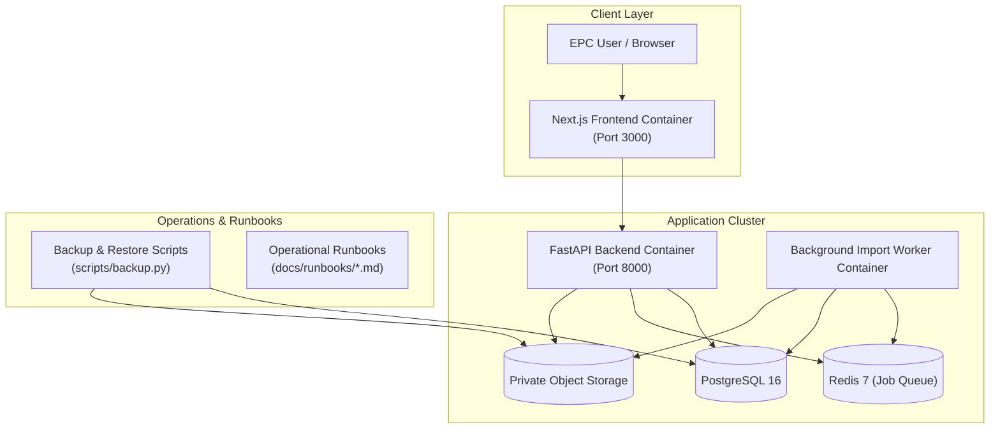

# PI-053 Deployment and Runbook Implementation Plan

> **For agentic workers:** REQUIRED SUB-SKILL: Use superpowers:subagent-driven-development to implement this plan task-by-task. Steps use checkbox (`- [ ]`) syntax for tracking.

**Goal:** Provide production-grade containerization, orchestration, health probes, automated backup & restore verification procedures, and operational incident runbooks for the Project Intelligence Platform.

**Architecture:**
1. **Containerization & Service Orchestration**: Production multi-stage Dockerfiles for backend (FastAPI API and asynchronous Import Worker) and frontend (Next.js with standalone / production output). A cohesive production `docker-compose.prod.yml` orchestrating API, Worker, Next.js Frontend, PostgreSQL 16, Redis 7, and Local Private Object Storage / MinIO with healthchecks and non-root execution.
2. **Production Worker Loop**: Standalone production worker entrypoint in `backend/app/workers/main.py` polling Redis/DB queues with graceful shutdown handling (SIGINT/SIGTERM), structured logs, and exponential backoff.
3. **Automated Backup & Restore**: Shell/PowerShell and Python scripts for point-in-time PostgreSQL dumps (`pg_dump` / `pg_restore`) and private file storage snapshots, verified via an automated test suite (`tests/test_backup_restore.py`).
4. **Operational Runbooks**: Standard Operating Procedures (SOPs) documented in `docs/runbooks/` covering:
   - System deployment, environment configuration, and verification checklist.
   - Database backup & restore validation and disaster recovery.
   - P6 XER & Tabular import failure diagnosis and recovery.
   - AI LLM provider outage handling, fallback policies, and circuit breaking.

**Architecture Diagram:**

**Tech Stack:** Docker, Docker Compose, PostgreSQL 16, Redis 7, FastAPI, Uvicorn, Next.js 16, Pydantic, Structlog, Pytest.

**Spec:** `08_DEVELOPMENT_BACKLOG.md` (Sprint 5, PI-053), `02_SYSTEM_ARCHITECTURE.md`.

## Global Constraints
- Production containers must run as unprivileged non-root users.
- Health checks must test both liveness (`/health`) and readiness (`/health/ready` probing DB + Redis).
- Backup & restore procedures must be reproducible, non-destructive to active tenants during backup, and covered by automated regression tests.
- Runbooks must provide actionable triage steps, error code lookups, and mitigation procedures.

---

### Task 1: Production Containerization (Backend, Worker, Frontend, Docker Compose Prod)

**Files:**
- Create: `backend/Dockerfile`
- Create: `frontend/Dockerfile`
- Create: `docker-compose.prod.yml`
- Modify: `backend/app/workers/main.py`
- Test: `backend/tests/test_docker_configs.py`

**Interfaces:**
- Produces:
  - Multi-stage production `Dockerfile` for backend: UV-based dependency installation, unprivileged `appuser` (UID 10001), healthcheck.
  - Multi-stage production `Dockerfile` for frontend: Node 20 / 22 build, standalone Next.js server, unprivileged `nextjs` user.
  - `docker-compose.prod.yml`: Cohesive production topology (`api`, `worker`, `web`, `postgres`, `redis`, `storage_volume`) with dependency health gates.
  - `backend/app/workers/main.py`: Production-ready daemon loop executing `process_next_job` with SIGTERM / SIGINT graceful exit.

- [ ] **Step 1: Write failing test for deployment configurations and worker daemon**
  Create `backend/tests/test_docker_configs.py` verifying Dockerfiles exist, have multi-stage builds, non-root users, correct entrypoints, and that `backend/app/workers/main.py` provides a runnable worker loop.

- [ ] **Step 2: Run test to make sure it fails**
  Run `cd backend; uv run pytest tests/test_docker_configs.py`.

- [ ] **Step 3: Implement Dockerfiles, production compose, and worker daemon**
  - Create `backend/Dockerfile` using python:3.11-slim, installing uv, creating `appuser`, setting entrypoint.
  - Create `frontend/Dockerfile` building Next.js and running standalone server.
  - Create `docker-compose.prod.yml` with healthchecks, environment mapping, and volume persistence.
  - Update `backend/app/workers/main.py` to run async loop with signal handling and queue polling.

- [ ] **Step 4: Run tests and verify**
  Run `cd backend; uv run pytest tests/test_docker_configs.py` and verify all tests pass.

---

### Task 2: Automated Database & Storage Backup & Restore Suite

**Files:**
- Create: `scripts/backup.py`
- Create: `scripts/restore.py`
- Create: `backend/tests/test_backup_restore.py`

**Interfaces:**
- Produces:
  - `backup_database(db_url, output_path)`: Exports PostgreSQL schema and data.
  - `restore_database(db_url, input_path)`: Re-applies backup to database safely.
  - `backup_storage(storage_dir, output_archive)`: Archives private file storage.
  - `restore_storage(input_archive, storage_dir)`: Restores private files and verifies checksums.
  - Automated tests validating data integrity across backup -> wipe -> restore cycles.

- [ ] **Step 1: Write failing test for backup and restore automation**
  Create `backend/tests/test_backup_restore.py` that populates a database and storage directory, runs backup, wipes data, runs restore, and verifies exact entity count and checksum equality.

- [ ] **Step 2: Run test to make sure it fails**
  Run `cd backend; uv run pytest tests/test_backup_restore.py`.

- [ ] **Step 3: Implement backup and restore utilities**
  Implement `scripts/backup.py` and `scripts/restore.py` with parameter validation, structured error codes, and cross-platform support.

- [ ] **Step 4: Run tests and verify**
  Run `cd backend; uv run pytest tests/test_backup_restore.py` and verify 100% pass.

---

### Task 3: Comprehensive Operational Incident Runbooks

**Files:**
- Create: `docs/runbooks/deployment-and-operations.md`
- Create: `docs/runbooks/database-backup-and-disaster-recovery.md`
- Create: `docs/runbooks/import-failure-triage.md`
- Create: `docs/runbooks/ai-provider-outage-and-fallback.md`
- Test: `backend/tests/test_runbook_integrity.py`

**Interfaces:**
- Produces: Complete, field-tested operational runbooks covering:
  1. `deployment-and-operations.md`: Single-command deployment, environment configuration reference, secrets management, health monitoring (`/health`, `/health/ready`), structured log aggregation.
  2. `database-backup-and-disaster-recovery.md`: Scheduled cron backups, cold standby restoration, point-in-time recovery, zero data loss verification.
  3. `import-failure-triage.md`: Diagnosis of P6 XER corruption, Excel mapping mismatches, missing required columns, worker deadlocks, stuck jobs, and retry SOPs.
  4. `ai-provider-outage-and-fallback.md`: OpenAI/Anthropic/Gemini rate limit exhaustion, 5xx outages, circuit-breaking, fallback adapter activation, and user messaging guidelines.

- [ ] **Step 1: Write failing test for runbook presence and link integrity**
  Create `backend/tests/test_runbook_integrity.py` asserting all required runbooks exist, contain required emergency triage sections, valid headers, and referenced script paths.

- [ ] **Step 2: Run test to make sure it fails**
  Run `cd backend; uv run pytest tests/test_runbook_integrity.py`.

- [ ] **Step 3: Author comprehensive operational runbooks**
  Write detailed, actionable documentation for all 4 SOP areas.

- [ ] **Step 4: Run tests and verify**
  Run `cd backend; uv run pytest tests/test_runbook_integrity.py` and verify all tests pass.

---

### Task 4: Monorepo Verification & Sprint 5 Completion

**Files:**
- Modify: `task.md`
- Modify: `08_DEVELOPMENT_BACKLOG.md`
- Verify: Full test suite, linting, typechecking, and production builds.

- [ ] **Step 1: Update task tracking and backlog**
  Mark PI-053 and Sprint 5 as completed in `task.md` and `08_DEVELOPMENT_BACKLOG.md`.

- [ ] **Step 2: Run full monorepo check and build**
  Execute `npm run check` and `npm --prefix frontend run build`.

